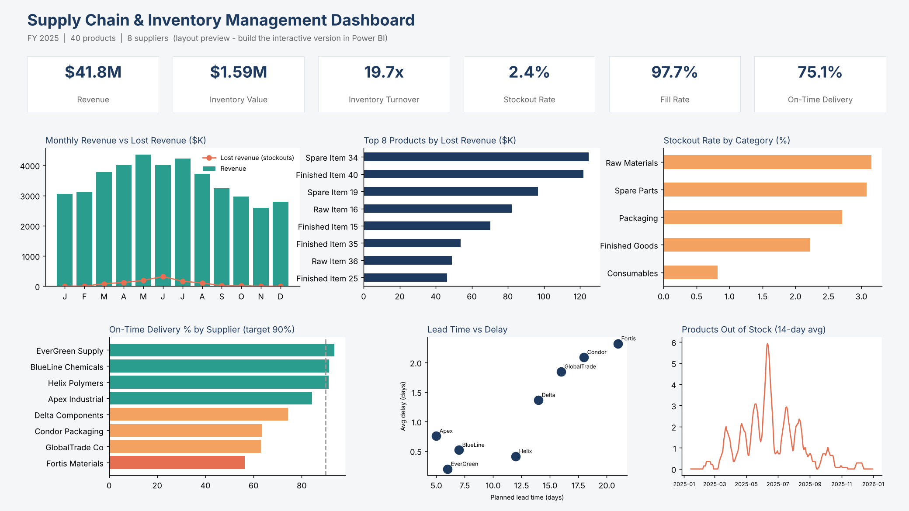

# Supply Chain & Inventory Management Dashboard

An interactive **Power BI** dashboard to monitor inventory levels, supplier performance, delivery efficiency and stock availability, built with **Power Query** and **DAX**.



> The image is a layout preview generated from the data with `scripts/make_preview.py`. Replace it with a screenshot of your finished Power BI report.

## Business questions answered
- Are we holding the right amount of stock? (inventory value, turnover, days of inventory)
- Where and when do stockouts happen, and how much revenue do they cost?
- Which suppliers deliver late, and does a longer lead time mean more delay?
- Which products need reordering first?

## Dataset
The data is **synthetic**, created by `scripts/generate_data.py`. It simulates a year (2025) of daily demand with a reorder-point policy for 40 products and 8 suppliers, with unreliable suppliers delivering late.

| File | Description | Rows |
|---|---|---|
| `dim_products.csv` | Category, cost, price, reorder point, supplier | 40 |
| `dim_suppliers.csv` | Region, planned lead time | 8 |
| `fact_inventory_daily.csv` | Daily demand, sales, closing stock, stockout flag | 14,600 |
| `fact_purchase_orders.csv` | Order, promised and actual delivery dates | 459 |

Regenerate with: `python scripts/generate_data.py`

## Data model (star schema)
```
dim_suppliers 1 --- * dim_products 1 --- * fact_inventory_daily * --- 1 dim_date
      1
      |
      * fact_purchase_orders * --- 1 dim_products
                             * --- 1 dim_date (order_date)
```

## How to build the report
1. Open Power BI Desktop > **Get Data > Text/CSV** (or paste the queries in `powerbi/power_query.m` into the Advanced Editor and update the folder path).
2. Create the date table and all measures from `powerbi/measures.dax`.
3. Set the relationships shown above (single direction, one-to-many).
4. Add the visuals:
   - **KPI cards:** Total Revenue, Inventory Value, Inventory Turnover, Stockout Rate %, Fill Rate %, On-Time Delivery %
   - **Column + line:** Total Revenue and Lost Revenue by month
   - **Bar:** Lost Revenue by product, Stockout Rate % by category
   - **Bar:** On-Time Delivery % by supplier (with a 90% target line)
   - **Scatter:** Avg Lead Time vs Avg Delay Days by supplier
   - **Slicers:** Date, Category, Supplier, Region
   - **Table:** products at or below reorder point (conditional formatting)

## Key measures (DAX)
`Inventory Turnover`, `Days of Inventory`, `Stockout Rate %`, `Fill Rate %`, `On-Time Delivery %`, `Avg Delay Days`, `Lost Revenue`, `Supplier Rating` - see [`powerbi/measures.dax`](powerbi/measures.dax).

## Insights from the sample data
- Fill rate is **97.7%**, but stockouts still cost revenue, peaking around May to July when demand is seasonally high.
- On-time delivery is **75.1%** overall. Fortis Materials (56%), GlobalTrade Co (63%) and Condor Packaging (64%) are the weakest, while EverGreen, BlueLine and Helix are above 90%.
- Longer planned lead times go with larger delays. Suppliers with 16+ day lead times are the main source of stockouts, so they need higher safety stock or a backup supplier.

## Tech stack
Power BI, Power Query (M), DAX, Python (pandas, NumPy, Matplotlib) for data generation.

## Repo structure
```
├── data/            CSV datasets
├── images/          dashboard preview
├── powerbi/         measures.dax, power_query.m  (+ your .pbix file)
├── scripts/         generate_data.py, make_preview.py
└── README.md
```
